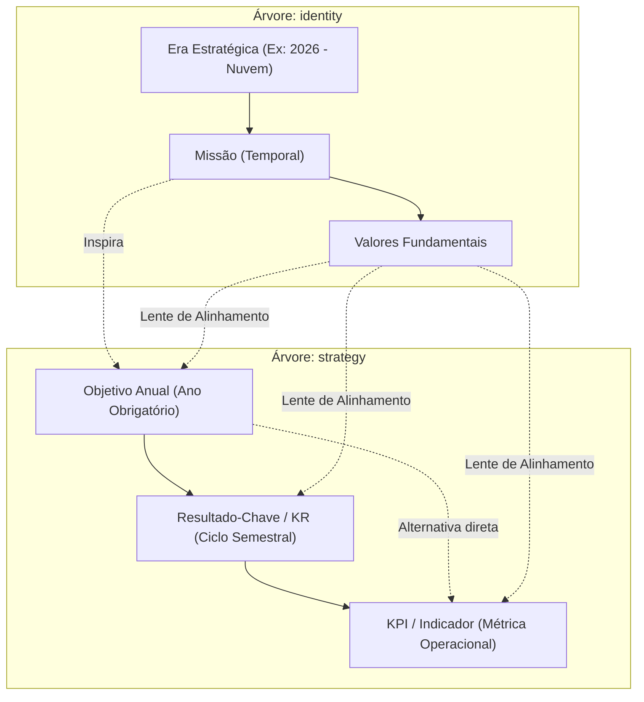
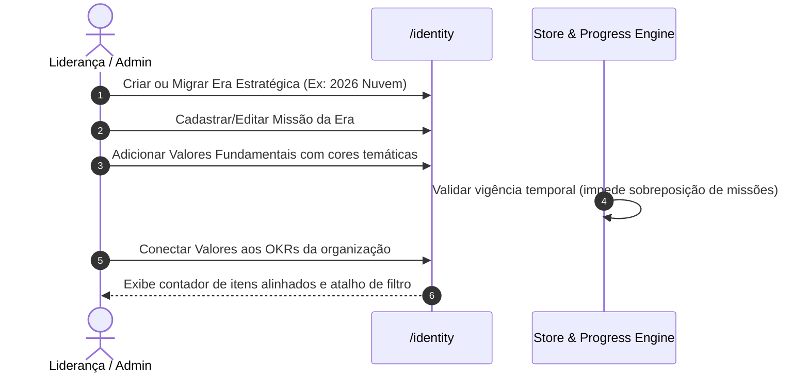
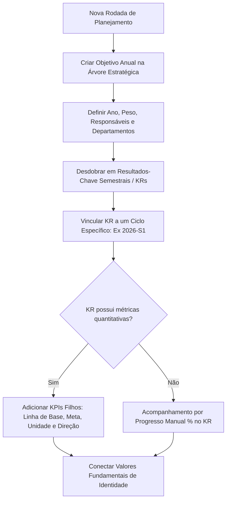
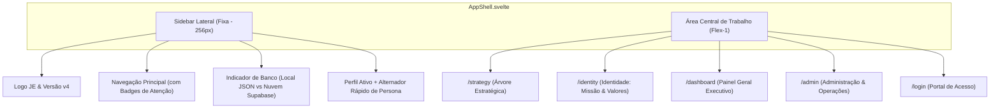

# JE Strategy OS v4 — Mapeamento de Processos e Layout da Interface (UI)

Este documento descreve detalhadamente a arquitetura de processos de negócio, modelo de governança e a estrutura completa de interface (Layout UI) do **JE Strategy OS v4** — sistema operacional de planejamento estratégico, desdobramento de OKRs e gestão de identidade para Empresas Juniores e organizações ágeis.

---

## 1. Visão Geral da Aplicação

O **JE Strategy OS** é uma aplicação web construída com **Svelte 5** (Runes), **SvelteKit 2**, **Tailwind CSS**, **Svelte Flow (@xyflow/svelte)** e **Dagre Layout Engine**. O sistema suporta persistência híbrida:
1. **Modo Local**: Banco de dados relacional baseado em JSON (`.data/local-db.json`) com suporte a troca rápida de personas e backups portáteis.
2. **Modo Supabase**: Autenticação com Row Level Security (RLS) e persistência PostgreSQL na nuvem via `@supabase/ssr`.

---

## 2. Modelo de Dados e Hierarquia Estratégica

A estrutura da aplicação é dividida em duas grandes árvores de nós (`node_tree`):



### Entidades Principais
* **`StrategyNode` (Nó Estratégico)**:
  * `type`: `mission` | `value` | `objective` | `key_result` | `kpi`.
  * `tree`: `identity` ou `strategy`.
  * `status`: `not_started`, `on_track`, `at_risk`, `off_track`, `done`.
  * `scope`: `year` (Objetivo), `cycle_id` (KR/KPI), `start_year`/`end_year` (Missão/Valor).
  * `kpi fields`: `unit`, `baseline`, `target_value`, `current_value`, `direction` (`up` | `down`).
  * `manual_progress`: Progresso manual (0.0 a 1.0) para KRs sem KPIs filhos.
* **`Cycle` (Ciclo Semestral)**: Código único (`2026-S1`, `2026-S2`), ano, semestre (1 ou 2), datas de início e fim.
* **`Profile` (Membro/Usuário)**: Nome, e-mail, cor de identificação, perfil de acesso (`admin`, `member`, `viewer`).
* **`Team` (Equipe/Departamento)**: Identificador, nome, cor institucional e descrição (ex.: *Presidência*, *Comercial*, *Marketing*, *Projetos*, *Gestão de Pessoas*, *Adm-Fin*).
* **`MetricUpdate` (Check-in de Métrica)**: Registro histórico contendo data, valor aferido, autor e anotação contextual.
* **Alinhamentos**:
  * `node_assignees`: Usuários responsáveis pelo item.
  * `node_teams`: Departamentos/equipes co-responsáveis pelo item.
  * `node_values`: Valores fundamentais conectados ao objetivo/KR/KPI.

---

## 3. Mapeamento dos Processos de Negócio

### Processo 1: Gestão de Identidade e Eras Estratégicas

* **Regras de Negócio**:
  * Apenas uma Missão pode estar ativa simultaneamente para o mesmo ano de vigência.
  * Valores pertencem à missão de sua respectiva Era e podem ser ativados como filtros dinâmicos na Árvore Estratégica.

---

### Processo 2: Cascata de OKRs (Planejamento e Desdobramento)


---

### Processo 3: Acompanhamento de Métricas & Rotina de Check-in
1. **Identificação**: O membro ou líder acessa o item via **Árvore Estratégica** (`/strategy`) ou pela fila de check-ins no **Painel Geral** (`/dashboard`).
2. **Abertura do Drawer (`NodeDrawer`)**: O usuário seleciona o KPI ou KR.
3. **Registro de Medição**:
   * O usuário insere o novo valor aferido (`value`) e uma nota explicativa opcional (`note`).
   * O sistema atualiza o `current_value` do KPI e gera uma entrada imutável em `metric_updates`.
4. **Visualização de Tendência**:
   * O drawer renderiza imediatamente um gráfico de linha (*sparkline* SVG) com o histórico de evolução a partir da linha de base (*baseline*).

---

### Processo 4: Motor de Cálculo de Progresso e Alertas de Risco
O sistema executa cálculos reativos contínuos através de `src/lib/progress.ts`:

```mermaid
flowchart TD
    subgraph 1. Cálculo de KPI
        K1["KPI: baseline, target_value, current_value, direction"]
        K1 --> K2["progress = (current - baseline) / (target - baseline)"]
        K2 --> K3["Inverte se direction == 'down'"]
        K3 --> K4["Clampa entre 0.0 e 1.0 (0% a 100%)"]
    end

    subgraph 2. Rollup Ponderado (Bottom-up)
        K4 --> KR1["KR progress = Média Ponderada dos KPIs filhos (por peso)"]
        KR1 --> O1["Objetivo progress = Média Ponderada dos KRs filhos (por peso)"]
    end

    subgraph 3. Detector Temporal de Risco (At-Risk)
        T1["Tempo Decorrido do Ciclo = (hoje - data_inicio) / (data_fim - data_inicio)"]
        T2{"(progresso + 0.20) < Tempo Decorrido?"}
        T1 --> T2
        T2 -- Sim --> R1["Status Alerta: AT RISK (Atraso crítico no ritmo)"]
        T2 -- Não --> R2["Mantém status normal ou on_track"]
    end
```

* **Regra de Detecção de Atraso**: Se o progresso atual acrescido de uma margem de segurança de $20\%$ for inferior ao percentual de tempo já consumido do ciclo, o item é marcado como `atRisk: true` e exibido no Painel de Atenção.

---

### Processo 5: Filtro por Lente de Valores (*Value Lens*)
* Ao selecionar um valor fundamental na barra de filtros ou na página de identidade, a URL recebe `?lens=<value_id>`.
* **Comportamento Visual**:
  * Os nós da Árvore Estratégica vinculados àquele valor recebem realce luminoso (*highlighted*).
  * Todos os outros nós não alinhados recebem opacidade reduzida (*dimmed* a $35\%$).
  * Permite auditar visualmente se todas as prioridades da empresa refletem a cultura e valores organizacionais.

---

### Processo 6: Operações de Governança e Backup de Dados
1. **Gerenciamento de Equipes e Permissões** (`/admin`):
   * Administradores criam/editam equipes com cores exclusivas e alocam membros.
   * Alternância entre papéis: *Admin* (gestão plena), *Member* (edição de metas/métricas) e *Viewer* (somente leitura).
2. **Ciclos Semestrais**:
   * Criação e ajuste de cronogramas semestrais (ano, semestre, datas de corte).
3. **Portabilidade e Backup**:
   * **Exportar Snapshot**: Download de backup completo em JSON (`je-strategy-os-export-YYYY-MM-DD.json`).
   * **Importar Snapshot**: Restauração integral de dados com validação de esquema.
   * **Restaurar Padrão EJ**: Re-aplicação do seed completo pré-configurado de Empresa Júnior.

---

## 4. Arquitetura de Layout da Interface (UI)

A interface é responsiva, intuitiva e segue uma paleta profissional baseada em tons `slate`, `indigo`, `emerald` e `amber`.



---

### 4.1 Barra Lateral (`AppShell.svelte`)
* **Topo**: Logotipo estilizado da EJ, nome do sistema `JE Strategy OS` e badge de versão `v4`.
* **Menu de Navegação**:
  * `Árvore Estratégica` (`/strategy`): Ícone de ramificação (`GitBranch`).
  * `Identidade (Missão e Valores)` (`/identity`): Ícone de bússola (`Compass`).
  * `Painel Geral` (`/dashboard`): Ícone de dashboard (`LayoutDashboard`), com **badge numérico âmbar** dinâmico indicando quantos itens precisam de atenção imediata.
  * `Administração e Dados` (`/admin`): Ícone de engrenagem (`Settings`).
* **Pill de Armazenamento**: Informa se a aplicação está rodando em modo Local (`.data/local-db.json`) ou conectada à Nuvem via Supabase.
* **Rodapé do Usuário**:
  * Avatar com iniciais e cor do usuário.
  * Nome do usuário e badge de permissão (*ADMIN*, *MEMBRO*, *VISUALIZADOR*).
  * Botão de Logout.
  * **No Modo Local**: Seletor *dropdown* instantâneo de persona para alternar entre Presidente, Diretores e Conselho Consultivo com 1 clique sem digitar senha.

---

### 4.2 Tela da Árvore Estratégica (`/strategy`)

Esta é a tela principal de navegação e operação tática.

```
┌───────────────────────────────────────────────────────────────────────────────────────────────────────┐
│ CycleFilterBar: [Ano: 2026 ▼] [Semestre: S1 | S2] [Strict: Off] [Lente de Valor: Todas ▼]            │
│                 [Busca: "Consultoria"...]   [Modo: ◉ Canvas  ○ Outline]   [+ Novo Objetivo Anual]     │
├────────────────────────────────────────────────────────────────────────┬──────────────────────────────┤
│ StrategyCanvas (Svelte Flow / Dagre Engine)                            │ NodeDrawer (Slide-over)      │
│                                                                        │                              │
│   [ Missão da Era: 2026 - Nuvem ]                                     │ [X] Editar Item              │
│                 │                                                      │                              │
│         ┌───────┴───────┐                                              │ Tipo: Resultado-Chave        │
│         ▼               ▼                                              │ Título: [ Fechar R$ 200k... ]│
│   ┌───────────┐   ┌───────────┐                                        │ Status: [ Em Andamento ▼ ]   │
│   │ Obj 2026  │   │ Obj 2026  │  (Controles de Zoom, Minimap,          │ Peso: [ 2 ]                  │
│   │ Expansão  │   │ Cultura   │   Inverter Orientação TB/LR,           │ Responsáveis: [ Valentina ]  │
│   └─────┬─────┘   └─────┬─────┘   Expandir / Colapsar Todos)           │ Equipes: [ Comercial, GP ]   │
│         │               │                                              │ Valores: [ ✓ Excelência ]    │
│   ┌─────┴─────┐         │                                              ├──────────────────────────────┤
│   ▼           ▼         ▼                                              │ Check-ins de Métrica (KPI)   │
│ ┌───────┐ ┌───────┐ ┌───────┐                                          │ Gráfico Sparkline histórico  │
│ │ KR S1 │ │ KR S2 │ │ KR S1 │                                          │ [+ Registrar Novo Valor]     │
│ └───┬───┘ └───────┘ └───────┘                                          ├──────────────────────────────┤
│     ▼                                                                  │ [ Excluir Item ]             │
│  ┌─────┐                                                               │ (Opção: promover filhos)     │
│  │ KPI │ (Métricas e barras de progresso integradas aos cartões)       │                              │
│  └─────┘                                                               │                              │
└────────────────────────────────────────────────────────────────────────┴──────────────────────────────┘
```

#### Componentes da Tela de Estratégia:
1. **`CycleFilterBar.svelte`**:
   * **Seletor de Anos**: Botões pill de múltipla escolha (2024, 2025, 2026, 2027).
   * **Seletor de Semestres**: Toggle rápido entre S1 e S2.
   * **Modo Estrito (*Strict Mode*)**: Quando ativo, oculta itens que não pertençam rigorosamente ao ciclo filtrado.
   * **Seletor de Lente de Valores**: Lista todos os valores com suas cores; ativa o realce e esmaecimento no grafo.
   * **Campo de Busca**: Busca em tempo real por títulos e descrições, mantendo a árvore de ancestrais visível para não quebrar a hierarquia.
   * **Alternador Canvas / Outline**: Alterna entre visualização em grafo e árvore hierárquica textual.
   * **Botão "+ Novo Objetivo"**: Abre o modal de criação de nó raiz anual.
2. **`StrategyCanvas.svelte`**:
   * Tela infinita com pan e zoom suave.
   * **Cartão de Missão (`StrategyMissionCard.svelte`)**: Posicionado no topo como norteador estratégico.
   * **Cartões de Nós (`StrategyNodeCard.svelte`)**:
     * Indicador visual de tipo (Objetivo, KR ou KPI).
     * Barra de progresso com porcentagem e código de cores.
     * Badges das equipes responsáveis (ex.: `#059669 Comercial`).
     * Avatares circulares com iniciais dos membros atribuídos.
     * Tags coloridas dos Valores alinhados.
     * Botão para recolher/expandir nós filhos (`toggleCollapse`).
     * Botão de adição rápida de nós filhos (`+`).
   * **Barra de Ferramentas Flutuante**: Alternância entre fluxo vertical (Top-to-Bottom) e horizontal (Left-to-Right), recolher todos e expandir todos.
3. **`OutlineView.svelte`**:
   * Visão alternativa em lista aninhada com acordeões expansíveis, barras de progresso compactas e botões de ação rápida.
4. **`NodeDrawer.svelte` (Painel Lateral de Detalhes)**:
   * Abre ao clicar em qualquer nó do canvas ou outline.
   * Permite editar título, descrição, status, peso, ano, ciclo semestral e item pai (reparentalização com validação anti-ciclos).
   * Seletor de responsáveis individuais e departamentos.
   * Checklist dos Valores Fundamentais para alinhamento de identidade.
   * **Para nós do tipo KPI**: Histórico completo de medições em tabela, sparkline interativo e formulário de check-in imediato.
   * **Exclusão Segura**: Permite excluir um nó e opcionalmente promover os KPIs filhos para o nó superior.
5. **Modal de Criação Rápida**:
   * Modal com backdrop translúcido para cadastrar novos Objetivos, KRs ou KPIs com validação instantânea de formulário.

---

### 4.3 Tela de Identidade Organizacional (`/identity`)

Focada na definição das bases perenes da organização:

```
┌─────────────────────────────────────────────────────────────────────────────────────────┐
│ Identidade Organizacional                                  [+ Novo Valor] [+ Nova Era]  │
│ Missão Estratégica e Valores Fundamentais estruturados ao longo dos ciclos de gestão.   │
├─────────────────────────────────────────────────────────────────────────────────────────┤
│ Eras: [ ◉ Era 2026 (Atual) ]  [ ○ Era 2024-2025 ]  [ ○ Linha do Tempo / Histórico ]     │
├─────────────────────────────────────────────────────────────────────────────────────────┤
│ ┌─────────────────────────────────────────────────────────────────────────────────────┐ │
│ │  MISSÃO ESTRATÉGICA DA ERA (2026)                                [ Editar Missão ]  │ │
│ │  "A excelência nasce de uma jornada do membro clara e potencializadora rumo ao      │ │
│ │   desenvolvimento coletivo."                                                        │ │
│ └─────────────────────────────────────────────────────────────────────────────────────┘ │
│                                                                                         │
│ VALORES FUNDAMENTAIS:                                                                   │
│ ┌─────────────────────────┐ ┌─────────────────────────┐ ┌─────────────────────────┐   │
│ │ Excelência em Entrega   │ │ Orgulho de Ser Nuvem    │ │ Foco no Cliente         │   │
│ │ Cor: Azul (#2563eb)     │ │ Cor: Âmbar (#d97706)    │ │ Cor: Esmeralda (#059669)│   │
│ │ Descrição do valor...   │ │ Descrição do valor...   │ │ Descrição do valor...   │   │
│ │ 8 itens alinhados       │ │ 5 itens alinhados       │ │ 12 itens alinhados      │   │
│ │ [Ver no Canvas →]       │ │ [Ver no Canvas →]       │ │ [Ver no Canvas →]       │   │
│ └─────────────────────────┘ └─────────────────────────┘ └─────────────────────────┘   │
└─────────────────────────────────────────────────────────────────────────────────────────┘
```

* **Abas de Eras**: Permite navegar entre a era atual e eras anteriores para consultar o histórico de diretrizes.
* **Cartão de Missão**: Apresentação heroica da missão com formulário inline de edição para administradores.
* **Cards de Valores**:
  * Badges de cores temáticas exclusivas.
  * Contador em tempo real de quantos objetivos, KRs e KPIs estão alinhados ao valor.
  * Botão de atalho `"Ver no Canvas →"` que redireciona diretamente para a Árvore Estratégica aplicando a Lente de Valor.

---

### 4.4 Painel Geral Executivo (`/dashboard`)

Visão centralizada de saúde estratégica e ritmo de entregas:

```
┌─────────────────────────────────────────────────────────────────────────────────────────┐
│ Painel Executivo de Estratégia                              [ Filtrar Ciclo: 2026-S1 ▼] │
├──────────────────────────┬──────────────────────────┬───────────────────────────────────┤
│ Progresso Geral          │ Objetivos Anuais         │ Resultados-Chave                  │
│ [ 68.4% ] (Barra Cheia)  │ [ 4 Ativos ]             │ [ 12 Monitorados ]                │
├──────────────────────────┴──────────────────────────┴───────────────────────────────────┤
│ ⚠️ ITENS QUE PRECISAM DE ATENÇÃO (AT RISK / OFF TRACK)                                  │
│ • Fechar R$ 200k em projetos no S1  ── Progresso: 18.0% (Ritmo esperado: 54.0%) ── [Comercial]│
│ • Capacitar 100% dos novos trainees ── Progresso: 22.0% (Ritmo esperado: 60.0%) ── [GP]       │
├─────────────────────────────────────────────────────────────────────────────────────────┤
│ ⏱️ FILA DE CHECK-IN DE KPIS (ORDENADOS POR NECESSIDADE DE ATUALIZAÇÃO)                  │
│ • SQLs Gerados no Mês     ── Atual: 14 / Meta: 35   ── Última medição: há 18 dias       │
│ • NPS Médio de Projetos   ── Atual: 82 / Meta: 90   ── Última medição: há 12 dias       │
└─────────────────────────────────────────────────────────────────────────────────────────┘
```

* **Métricas Principais**: Cards consolidados com progresso ponderado geral, contagem de objetivos, KRs e KPIs.
* **Tabela de Atenção (*At-Risk Attention Table*)**: Destaca imediatamente todas as metas defasadas em relação ao calendário, evitando surpresas de final de semestre.
* **Fila de Check-in de Indicadores**: Lista os KPIs cuja data da última medição é mais antiga, orientando reuniões de alinhamento e rituais de governança.

---

### 4.5 Administração & Operações (`/admin`)

Painel restrito para configuração organizacional:
1. **Equipes & Departamentos**: Cadastro de diretorias, atribuição de cores de identificação visual e listagem de membros pertencentes.
2. **Usuários & Permissões**: Lista de perfis, ajuste de papéis (*Admin*, *Membro*, *Visualizador*) e vínculo departamental.
3. **Ciclos Semestrais**: Configuração dos períodos semestrais vigentes e futuros.
4. **Gerenciamento de Dados**:
   * **Exportar Snapshot**: Download de cópia completa do estado do sistema.
   * **Importar Snapshot**: Upload com validação de esquema Zod para restaurar ambientes.
   * **Restaurar Padrão EJ**: Restaura a estrutura de planejamento estratégico pré-configurada da Empresa Júnior.

---

### 4.6 Portal de Acesso (`/login`)
* **Modo Nuvem**: Login seguro com e-mail e senha integrado ao Supabase Auth.
* **Modo Local (Ambiente de Demonstração / Offline)**:
  * Grade de seleção de perfis em 1 clique (Valentina Kunz - Presidente Admin, Lucas Mendes - Dir. Comercial, Beatriz Costa - Dir. Projetos, Rafael Souza - Dir. GP, Conselho Consultivo - Viewer).
  * Permite testar imediatamente a experiência de cada tipo de permissão sem atritos de credenciais.

---

## 5. Resumo das Regras de Acesso e Permissões (RBAC)

| Ação / Funcionalidade | Administrador (`admin`) | Membro (`member`) | Visualizador (`viewer`) |
| :--- | :---: | :---: | :---: |
| Visualizar Árvore, Dashboard e Identidade | Sim | Sim | Sim |
| Navegar com Lentes de Valores e Filtros | Sim | Sim | Sim |
| Criar/Editar/Excluir Objetivos, KRs e KPIs | Sim | Sim | Não |
| Registrar Check-in de Métricas e Notas | Sim | Sim | Não |
| Editar Missão e Criar Valores Fundamentais | Sim | Sim | Não |
| Criar Eras Estratégicas | Sim | Não | Não |
| Gerenciar Equipes e Departamentos | Sim | Não | Não |
| Alterar Papéis de Usuários | Sim | Não | Não |
| Configurar Ciclos Semestrais | Sim | Não | Não |
| Exportar Backups JSON | Sim | Sim | Sim |
| Importar Backups ou Restaurar Seed Padrão | Sim | Não | Não |
