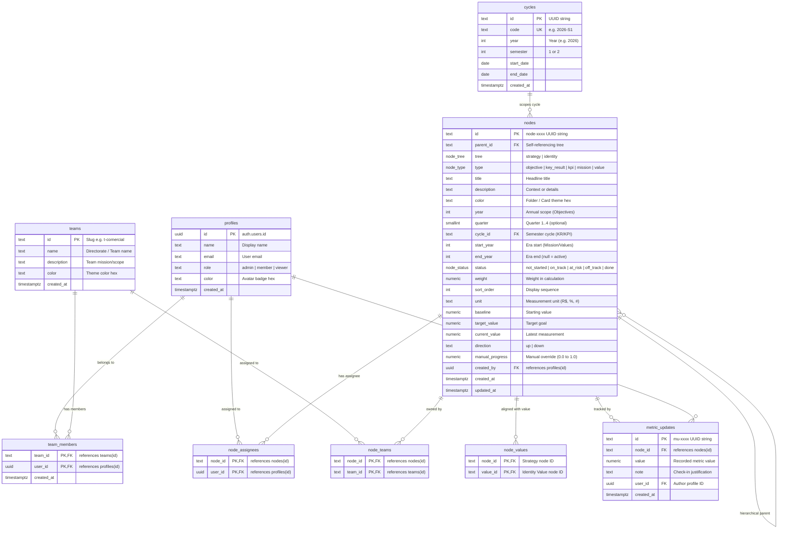

# JE Strategy OS — Database Schema & Architecture

This document provides a comprehensive technical reference for the database schema of the **JE Strategy OS** platform. It covers all PostgreSQL tables, relations, constraints, custom enums, database triggers, Row-Level Security (RLS) policies, and their operational roles in the strategic execution lifecycle.

---

## 1. Entity-Relationship Diagram (ERD)

The diagram below illustrates the 9 core tables in the database, their primary keys, foreign keys, and cardinalities.



---

## 2. Dual-Tree Strategic Architecture

The platform splits strategic data into two distinct trees defined by `nodes.tree`:

```mermaid
graph TD
    subgraph IdentityTree["Identity Tree (tree = 'identity')"]
        Mission["Mission (type = 'mission')<br/>Institutional Purpose & Era (e.g. 2024-2026)"]
        Value["Value (type = 'value')<br/>Core Cultural Principles"]
        Mission -->|parent_id| Value
    end

    subgraph StrategyTree["Strategy Tree (tree = 'strategy')"]
        Objective["Objective (type = 'objective')<br/>Annual Horizon (e.g. 2026)"]
        KeyResult["Key Result (type = 'key_result')<br/>Tactical Milestone scoped to Cycle (e.g. 2026-S1)"]
        KPI["Operational KPI (type = 'kpi')<br/>Quantitative Metric with Target & Baseline"]

        Objective -->|parent_id| KeyResult
        Objective -->|parent_id (direct)| KPI
        KeyResult -->|parent_id| KPI
    end

    Objective -.->|node_values alignment| Value
    KeyResult -.->|node_values alignment| Value
    KPI -.->|node_values alignment| Value
```

### Tree Invariants (Enforced via `validate_parent()` trigger):
1. **Roots**: Only `mission` or `objective` nodes can have `parent_id = NULL`.
2. **Valid Hierarchies**:
   - `mission` $\rightarrow$ `value`
   - `objective` $\rightarrow$ `key_result`
   - `objective` $\rightarrow$ `kpi` (Direct KPI under an Objective)
   - `key_result` $\rightarrow$ `kpi` (Operational KPI driving a KR)
3. **No Cross-Tree Parenting**: An identity node cannot parent a strategy node, and vice versa.
4. **Alignment vs Parenting**: Aligned organizational values are connected across trees via `node_values`, never through `parent_id`.

---

## 3. Detailed Table-by-Table Reference

### 3.1. `profiles`
* **Purpose**: Extends Supabase authentication (`auth.users`) to store application-level user identity, authorization roles, initials avatar coloring, and profile metadata.
* **Synchronization**: Automatically populated on signup via the `handle_new_user()` PostgreSQL trigger.
* **Fields**:
  | Column | Type | Nullable | Default | Description |
  | :--- | :--- | :--- | :--- | :--- |
  | `id` | `uuid` | No | — | Primary Key, references `auth.users(id) ON DELETE CASCADE` |
  | `name` | `text` | No | — | Full display name (extracted from Google/OAuth metadata) |
  | `email` | `text` | Yes | — | Email address |
  | `role` | `text` | No | `'member'` | Permission level: `'admin'`, `'member'`, or `'viewer'` |
  | `color` | `text` | Yes | — | Hex code for avatar badge (e.g., `#0284c7`) |
  | `created_at` | `timestamptz` | No | `now()` | Registration timestamp |

---

### 3.2. `teams`
* **Purpose**: Represents organizational directorates, functional departments, or cross-functional squads (e.g., *Presidência*, *Comercial*, *Marketing*, *Projetos*, *Gestão de Pessoas*, *Administrativo-Financeiro*).
* **Fields**:
  | Column | Type | Nullable | Default | Description |
  | :--- | :--- | :--- | :--- | :--- |
  | `id` | `text` | No | `gen_random_uuid()` | Slug or ID (e.g., `t-comercial`, `t-projetos`) |
  | `name` | `text` | No | — | Department or Directorate title |
  | `description` | `text` | Yes | — | Mission, scope, and objectives of the directorate |
  | `color` | `text` | Yes | `'#2563eb'` | Brand color hex for tabs, badges, and folders |
  | `created_at` | `timestamptz` | No | `now()` | Creation timestamp |

---

### 3.3. `team_members`
* **Purpose**: Many-to-many junction table assigning profiles to one or more directorates/teams.
* **Fields**:
  | Column | Type | Nullable | Default | Description |
  | :--- | :--- | :--- | :--- | :--- |
  | `team_id` | `text` | No | — | References `teams(id) ON DELETE CASCADE` |
  | `user_id` | `uuid` | No | — | References `profiles(id) ON DELETE CASCADE` |
  | `created_at` | `timestamptz` | No | `now()` | Membership assignment timestamp |
* **Keys**: Composite Primary Key `(team_id, user_id)`.

---

### 3.4. `cycles`
* **Purpose**: Defines discrete execution timeframes (semesters) for Key Results and KPIs (e.g., `2026-S1`, `2026-S2`).
* **Fields**:
  | Column | Type | Nullable | Default | Description |
  | :--- | :--- | :--- | :--- | :--- |
  | `id` | `text` | No | `gen_random_uuid()` | Unique identifier |
  | `code` | `text` | No | — | Human-readable identifier (Unique, e.g., `'2026-S1'`) |
  | `year` | `int` | No | — | Planning year (e.g., `2026`) |
  | `semester` | `int` | No | — | Semester index (`1` or `2`) |
  | `start_date` | `date` | No | — | Start of the semester period |
  | `end_date` | `date` | No | — | End of the semester period |
  | `created_at` | `timestamptz` | No | `now()` | Timestamp |
* **Constraints**: `UNIQUE (year, semester)`.

---

### 3.5. `nodes`
* **Purpose**: The central entity of the system. Unifies Mission, Organizational Values, Objectives, Key Results, and KPIs into a single polymorphic hierarchy.
* **Fields**:
  | Column | Type | Nullable | Default | Description |
  | :--- | :--- | :--- | :--- | :--- |
  | `id` | `text` | No | `gen_random_uuid()` | Node identifier (e.g., `node-a1b2c3d4`) |
  | `parent_id` | `text` | Yes | `NULL` | Hierarchical parent referencing `nodes(id) ON DELETE CASCADE` |
  | `tree` | `node_tree` | No | — | Tree domain: `'strategy'` or `'identity'` |
  | `type` | `node_type` | No | — | `'mission'`, `'value'`, `'objective'`, `'key_result'`, or `'kpi'` |
  | `title` | `text` | No | — | Main title or label |
  | `description`| `text` | Yes | `NULL` | Detailed description or context |
  | `color` | `text` | Yes | `NULL` | Custom folder/card pastel tint and accent hex |
  | `year` | `int` | Yes | `NULL` | Applicable to Annual Objectives |
  | `quarter` | `smallint` | Yes | `NULL` | Optional quarterly scope (1..4) |
  | `cycle_id` | `text` | Yes | `NULL` | References `cycles(id) ON DELETE SET NULL` for KRs/KPIs |
  | `start_year` | `int` | Yes | `NULL` | Starting era year for Mission/Values |
  | `end_year` | `int` | Yes | `NULL` | Ending era year (`NULL` = active current era) |
  | `status` | `node_status`| No | `'not_started'`| Execution health: `'not_started'`, `'on_track'`, `'at_risk'`, `'off_track'`, `'done'` |
  | `weight` | `numeric` | No | `1` | Weight for parent progress roll-up calculations |
  | `sort_order` | `int` | No | `0` | Order of appearance within sibling list |
  | `unit` | `text` | Yes | `NULL` | KPI measurement unit (e.g., `'R$'`, `'%'`, `'projetos'`, `'dias'`) |
  | `baseline` | `numeric` | Yes | `NULL` | Initial KPI starting measurement |
  | `target_value`| `numeric`| Yes | `NULL` | Goal target metric |
  | `current_value`|`numeric`| Yes | `NULL` | Current recorded metric (auto-synced via check-ins) |
  | `direction` | `text` | Yes | `NULL` | Optimization target: `'up'` (higher is better) or `'down'` (lower is better) |
  | `manual_progress`|`numeric`| Yes | `NULL` | Manual progress override (0.00 to 1.00) for qualitative KRs |
  | `created_by` | `uuid` | Yes | `NULL` | References `profiles(id)` |
  | `created_at` | `timestamptz`| No | `now()` | Node creation date |
  | `updated_at` | `timestamptz`| No | `now()` | Auto-updated via `touch_updated_at()` trigger |

---

### 3.6. `node_assignees`
* **Purpose**: Assigns individual members (responsible owners/collaborators) to Objectives, Key Results, or KPIs.
* **Fields**:
  | Column | Type | Nullable | Description |
  | :--- | :--- | :--- | :--- |
  | `node_id` | `text` | No | References `nodes(id) ON DELETE CASCADE` |
  | `user_id` | `uuid` | No | References `profiles(id) ON DELETE CASCADE` |
* **Keys**: Composite Primary Key `(node_id, user_id)`.

---

### 3.7. `node_teams`
* **Purpose**: Assigns responsible directorates or departments to Objectives, Key Results, or KPIs.
* **Fields**:
  | Column | Type | Nullable | Description |
  | :--- | :--- | :--- | :--- |
  | `node_id` | `text` | No | References `nodes(id) ON DELETE CASCADE` |
  | `team_id` | `text` | No | References `teams(id) ON DELETE CASCADE` |
* **Keys**: Composite Primary Key `(node_id, team_id)`.

---

### 3.8. `node_values`
* **Purpose**: Establishes cross-tree cultural alignment. Maps strategy nodes (`objective`, `key_result`, `kpi`) to one or more institutional values (`value`).
* **Fields**:
  | Column | Type | Nullable | Description |
  | :--- | :--- | :--- | :--- |
  | `node_id` | `text` | No | References a strategy node in `nodes(id)` |
  | `value_id`| `text` | No | References a cultural value node in `nodes(id)` |
* **Validation Trigger**: `validate_node_value()` verifies that `node_id` is in tree `'strategy'` and `value_id` is of type `'value'`.

---

### 3.9. `metric_updates`
* **Purpose**: Audit log and chronological measurement ledger for KPIs. Tracks check-in notes, quantitative updates, timestamps, and reporting authors.
* **Fields**:
  | Column | Type | Nullable | Default | Description |
  | :--- | :--- | :--- | :--- | :--- |
  | `id` | `text` | No | `gen_random_uuid()` | Check-in entry ID |
  | `node_id` | `text` | No | — | References KPI node in `nodes(id) ON DELETE CASCADE` |
  | `value` | `numeric` | No | — | Quantitative measurement reported |
  | `note` | `text` | Yes | — | Check-in commentary, actions taken, or blockers |
  | `user_id` | `uuid` | Yes | — | Author profile who logged the check-in |
  | `created_at` | `timestamptz` | No | `now()` | Check-in timestamp |

---

## 4. Automation Triggers & Business Logic

The database enforces business rules and reactive synchronizations natively at the PostgreSQL level:

```mermaid
flowchart TD
    subgraph S1["Auth Trigger: On User Signup"]
        A["auth.users (New Signup)"] -->|INSERT| B["handle_new_user()"]
        B --> C["public.profiles (Auto-provisioned)"]
    end

    subgraph S2["Hierarchy Trigger: On Node Upsert"]
        D["nodes (INSERT or UPDATE)"] -->|BEFORE| E["validate_parent()"]
        E -->|Valid Hierarchy| F["nodes (Committed)"]
        E -->|Invalid Parent Type or Tree| G["RAISE EXCEPTION (Rollback)"]
    end

    subgraph S3["Check-in Trigger: On Metric Check-in"]
        H["metric_updates (INSERT)"] -->|AFTER| I["sync_kpi_current_value()"]
        I --> J["nodes.current_value updated in real-time"]
    end

    subgraph S4["Timestamp Trigger: On Node Update"]
        K["nodes (UPDATE)"] -->|BEFORE| L["touch_updated_at()"]
        L --> M["nodes.updated_at = now()"]
    end
```



---

## 5. Security & Row-Level Security (RLS)

Every table has Row-Level Security enabled (`ENABLE ROW LEVEL SECURITY`). Access control is governed by user role:

| Table | Authenticated Viewer | Authenticated Member (Editor) | Admin |
| :--- | :---: | :---: | :---: |
| `profiles` | Read all | Update self (`name`, `color`) | Full CRUD |
| `teams` | Read all | Read all | Full CRUD |
| `team_members` | Read all | Read all | Full CRUD |
| `cycles` | Read all | Read all | Full CRUD |
| `nodes` | Read all | Full CRUD (Create/Edit/Delete) | Full CRUD |
| `node_assignees`| Read all | Full CRUD | Full CRUD |
| `node_teams` | Read all | Full CRUD | Full CRUD |
| `node_values` | Read all | Full CRUD | Full CRUD |
| `metric_updates`| Read all | Insert own check-ins | Full CRUD |

---

## 6. Real-World Record Examples

### A. Strategic Objective (Root)
```json
{
  "id": "node-obj-01",
  "parent_id": null,
  "tree": "strategy",
  "type": "objective",
  "title": "Atingir R$ 250k em Faturamento e Alta Eficiência Operacional",
  "year": 2026,
  "status": "on_track",
  "color": "#0058bd",
  "weight": 1
}
```

### B. Tactical Key Result (Child of Objective)
```json
{
  "id": "node-kr-01",
  "parent_id": "node-obj-01",
  "tree": "strategy",
  "type": "key_result",
  "title": "Consolidar R$ 120k em Faturamento no Ciclo 2026-S1",
  "cycle_id": "cycle-2026-s1",
  "status": "on_track",
  "color": "#ca8a04",
  "weight": 1
}
```

### C. Operational KPI (Child of Key Result)
```json
{
  "id": "node-kpi-01",
  "parent_id": "node-kr-01",
  "tree": "strategy",
  "type": "kpi",
  "title": "Faturamento Bruto Acumulado",
  "cycle_id": "cycle-2026-s1",
  "unit": "R$",
  "baseline": 0,
  "target_value": 120000,
  "current_value": 84500,
  "direction": "up",
  "status": "on_track",
  "color": "#059669"
}
```
